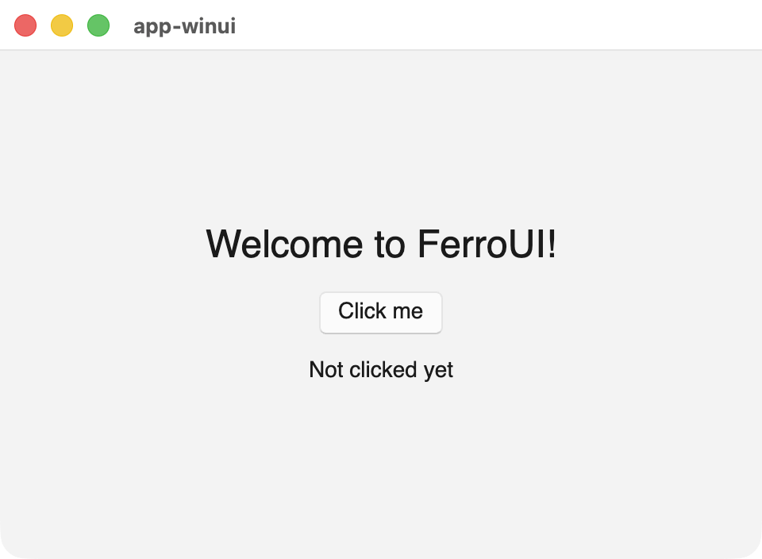
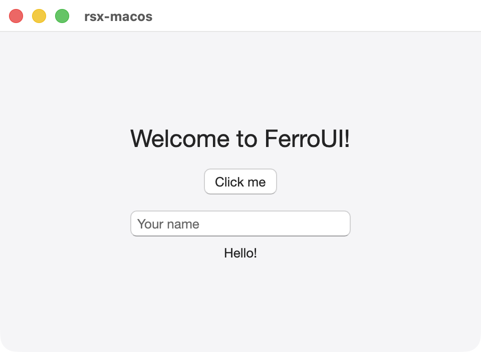

# FerroUI templates

Project and item templates for [FerroUI](https://github.com/wieslawsoltes/FerroUI), a cross-platform
UI framework for Rust with XAML, a declarative Rust API and native platform backends. They are the
Rust counterpart of the `dotnet new` templates of .NET UI frameworks, made with
[cargo-generate](https://github.com/cargo-generate/cargo-generate).

| `app`, WinUI 3 theme | `rsx`, macOS 26 theme |
|---|---|
|  |  |

## Quick start

```sh
cargo install cargo-generate

# A desktop application in XAML with the MVVM pattern
cargo generate --git https://github.com/FerroUI/templates app --name my-app
cd my-app
cargo run
```

Every option can be given on the command line instead of answering its prompt:

```sh
cargo generate --git https://github.com/FerroUI/templates app --name my-app \
    --define theme=fluent --define mvvm=reactiveui

cargo generate --git https://github.com/FerroUI/templates rsx --name my-app --define theme=macos

cargo generate --git https://github.com/FerroUI/templates cross-platform --name my-app \
    --define theme=winui --define ios=false --define app_id=org.example.myapp
```

Without a template name, `cargo generate --git https://github.com/FerroUI/templates` asks for one.

## Project templates

| Template | What it creates | Options |
|---|---|---|
| `app` | A desktop application in XAML with the MVVM pattern: `App.xaml`, `views/MainWindow.xaml` and a view model with a test | `theme`, `mvvm` |
| `app-codebehind` | A desktop application in XAML with code-behind: `App.xaml` and `MainWindow.xaml` with an event handler, no view models | `theme` |
| `declarative` | A desktop application written with the builders of `ferroui-view` (`stack_panel()`, `button()`) and signals, no XAML | `theme` |
| `rsx` | A desktop application written with the React-like API: `rsx!`, `#[component]`, signals and hooks (`use_signal`, `#[component(rerender)]`) | `theme` |
| `cross-platform` | An application repository: a shared crate in XAML with the MVVM pattern and desktop, browser, Android and iOS hosts, FerroUI as a git submodule and CI with GitHub Pages | `theme`, `desktop`, `browser`, `android`, `ios`, `app_id` |
| `control-library` | A library crate with a templated control (styled properties with `ferro_properties!`), its control theme in XAML and its registration | `control` |

## Item templates

An item template generates a folder with one item and a `README.md` that says how to wire it into a
project generated from the templates above; move the files into the project and delete the folder.

| Template | What it creates | Options |
|---|---|---|
| `window` | A window: `<Name>.xaml` with `x:Class` and its class, `<name>.rs` | `namespace` |
| `user-control` | A user control: `<Name>.xaml` with `x:Class` and its class, `<name>.rs` | `namespace` |
| `templated-control` | A templated control: its class with styled properties, `<name>.rs`, and its control theme, `<Name>Theme.xaml` | `namespace` |
| `resource-dictionary` | A resource dictionary, `<Name>.xaml`, for `ResourceInclude` | |
| `styles` | A set of styles, `<Name>.xaml`, for `StyleInclude` | |

```sh
cd my-app/src/views
cargo generate --git https://github.com/FerroUI/templates window --name SettingsWindow \
    --define namespace=MyApp.Views
```

## Options

| Option | Values | Default | Templates |
|---|---|---|---|
| `theme` | `winui` (WinUI 3, `ferroui-themes-winui`), `fluent` (Fluent, `ferroui-themes-fluent`), `simple` (Simple, `ferroui-themes-simple`), `macos` (macOS 26, `ferroui-themes-macos`), `material` (Material 3 Expressive, `ferroui-themes-material`, with its Roboto fonts) | `winui` | `app`, `app-codebehind`, `declarative`, `rsx`, `cross-platform` |
| `mvvm` | `minimal` (a view model base of the template, `INotifyPropertyChanged`), `reactiveui` (ReactiveUI: `ReactiveObject`, `ReactiveCommand`, `ObservableAsPropertyHelper`) | `minimal` | `app` |
| `desktop`, `browser`, `android`, `ios` | `true`, `false`: the hosts the repository has (at least one) | `true` | `cross-platform` |
| `app_id` | The application id of the Android and iOS hosts | `com.example.<name>` | `cross-platform` |
| `control` | The name of the control, in PascalCase | `InfoCard` | `control-library` |
| `namespace` | The XAML namespace of the module the item goes into (`MyApp.Views`) | `MyApp.Views` | `window`, `user-control`, `templated-control` |

## Dependencies

The single-crate templates (`app`, `app-codebehind`, `declarative`, `rsx`, `control-library`)
depend on the FerroUI crates on crates.io, every one at the same exact version (`=0.4.0`): the
crates of a release depend on one another at exactly its version. To move a generated project to a
later release, change the version of every FerroUI crate at once.

The `cross-platform` template uses the layout of an application repository
([FerroUI/docs/apps.md](https://github.com/wieslawsoltes/FerroUI/blob/main/docs/apps.md)): FerroUI
is a git submodule at `FerroUI/`, the crates are path dependencies into it, kept in sync by
`FerroUI/scripts/apps/sync-workspace.py`, and CI is FerroUI's reusable workflow
`wieslawsoltes/FerroUI/.github/workflows/app.yml@main`. After generating, run `scripts/setup.sh`
once in the new project: it adds the submodule, writes the FerroUI blocks of `Cargo.toml` and
starts `Cargo.lock`.

```sh
cargo generate --git https://github.com/FerroUI/templates cross-platform --name my-app
cd my-app
scripts/setup.sh
cargo run -p my-app-desktop
```

## Requirements

Rust 1.89 or later and the platform requirements of FerroUI
([README, Installation](https://github.com/wieslawsoltes/FerroUI#installation)). The first build
downloads a prebuilt Skia and builds HarfBuzz from source; it takes a while. Run an application with
`cargo run --profile fast-release` for an optimised build without the cost of the `dist` profile.

## CI

`.github/workflows/ci.yml` generates every template with `cargo generate --path . <template>
--name <name> --silent --define ...` and builds the generated projects on Linux:

| Job | What it does |
|---|---|
| Conventions | `scripts/check-conventions.py`: no upstream framework name, `ferro_thread_local!` only, no emoji, one FerroUI version, the shared files (`shared/`) in sync |
| `app` | One project per theme, with both MVVM libraries: `cargo check --workspace --all-targets` and `cargo test --workspace` |
| `app-codebehind`, `declarative`, `rsx` | One project per theme: `cargo check` and `cargo test` |
| `control-library` | Two control names: `cargo check` and `cargo test` (the control theme is loaded and applied in a window) |
| Item templates | An `app` project with every item added as its README says (`scripts/items-smoke.sh`), with a test that creates each item: `cargo test` |
| cross-platform (desktop, tests) | All four hosts with the submodule set up by `scripts/setup.sh`: `cargo check --workspace --all-targets`, `cargo test --workspace`, `cargo build -p my-app-desktop`, `sync-workspace.py --check`; and a project with some of the hosts, checked for the files and the application id |
| cross-platform (browser site) | The site built with `FerroUI/scripts/build-browser.sh` and a smoke run in headless Chrome |
| cross-platform (Android package) | The APK packaged with `FerroUI/scripts/android/apk.sh` |
| cross-platform (iOS bundle) | The application bundle for the simulator built with `FerroUI/scripts/ios/bundle.sh`, on macOS |

The single-crate templates take FerroUI from crates.io (`FERROUI: crates.io` in the workflow). For
a release that is not published yet, set `FERROUI` to a branch of FerroUI:
`scripts/patch-ferroui.py` then points the generated project at a checkout of that branch with a
`[patch.crates-io]` section.

Locally:

```sh
scripts/smoke.sh app /tmp/smoke/app-fluent --define theme=fluent --define mvvm=reactiveui
FERROUI_CHECKOUT=~/FerroUI scripts/smoke.sh rsx /tmp/smoke/rsx-macos --define theme=macos
python3 scripts/check-conventions.py
```

## Layout

```
cargo-generate.toml          the list of templates (sub_templates)
app/, app-codebehind/, ...   one folder per template, each with its cargo-generate.toml
shared/                      the files several templates copy (build.rs, theme.rhai, LICENSE);
                             the conventions check keeps the copies the same
scripts/                     smoke.sh, items-smoke.sh, patch-ferroui.py, check-conventions.py
```

## License

MIT, see [LICENSE](LICENSE). The generated projects are MIT licensed as well.
